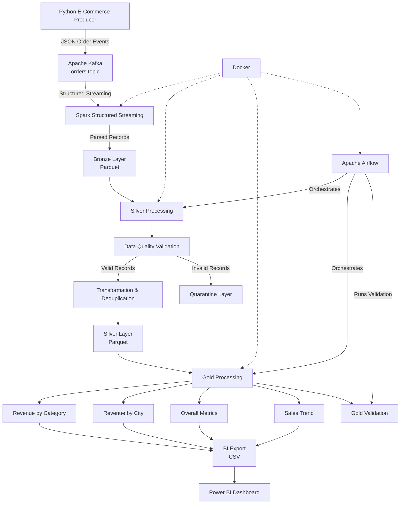
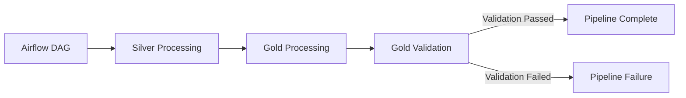

# System Architecture

## Real-Time E-Commerce Data Platform



---

## End-to-End Data Flow

```text
Python Producer
      │
      ▼
Apache Kafka
      │
      ▼
Spark Structured Streaming
      │
      ▼
Bronze Parquet
      │
      ▼
Silver Processing
      │
      ├──────────────► Quarantine
      │                 Invalid Records
      │
      ▼
Silver Parquet
      │
      ▼
Gold Processing
      │
      ├── Revenue by Category
      ├── Revenue by City
      ├── Overall Metrics
      └── Sales Trend
      │
      ▼
BI Export
      │
      ▼
Power BI
```

---

## Processing Responsibilities

| Layer | Responsibility |
|---|---|
| Producer | Generate e-commerce order events |
| Kafka | Buffer and decouple event ingestion |
| Bronze | Persist source-oriented streaming data |
| Silver | Validate, transform and deduplicate data |
| Quarantine | Preserve invalid records for investigation |
| Gold | Generate business-level analytical datasets |
| BI Export | Convert Gold Parquet into reporting-ready CSV |
| Power BI | Visualize business KPIs and trends |
| Airflow | Orchestrate processing and validation |
| Docker | Provide reproducible execution environments |

---

## Orchestration Flow



The current Airflow workflow is:

```text
Silver Processing
       ↓
Gold Processing
       ↓
Gold Validation
```

---

## Storage Architecture

```text
spark/
│
├── bronze/
│   └── Raw parsed Kafka events
│
├── silver/
│   └── Validated and deduplicated records
│
├── quarantine/
│   └── Invalid records
│
├── gold/
│   ├── revenue_by_category/
│   ├── revenue_by_city/
│   ├── overall_metrics/
│   └── sales_trend/
│
└── bi_export/
    ├── revenue_by_category.csv
    ├── revenue_by_city.csv
    ├── overall_metrics.csv
    └── sales_trend.csv
```

## Processing flow

```text
producer/run.py -> Kafka topic orders -> spark/run.py
  -> parse Kafka value as order JSON -> append Parquet to spark/bronze/
  -> spark/run_silver_batch.py -> valid rows to spark/silver/data/
                         -> invalid rows to spark/quarantine/data/
  -> spark/run_gold.py -> four Parquet analytical datasets in spark/gold/
  -> spark/export_gold_to_csv.py -> spark/bi_export/*.csv -> Power BI
```

`airflow/dags/ecommerce_pipeline.py` orchestrates the Silver batch, Gold batch, and Gold validation in that order. Streaming ingestion is a separate long-running process; it is not a task in the DAG.

## Components

### Producer and Kafka

The root `producer.py` publishes five fixed order records using `kafka-python`, waiting two seconds between sends. The `producer/` package files are empty scaffolding. The root `docker-compose.yml` starts a single ZooKeeper and Kafka broker. Kafka exposes `localhost:9092` for clients on the host and `kafka:29092` for clients on the Compose network. The sample deployment uses plaintext listeners.

### Spark Bronze

`spark/app/consumers/kafka_consumer.py` reads the `orders` topic; `spark/app/parsers/order_parser.py` casts Kafka `value` to text and parses it using `order_schema`. `spark/app/services/streaming_service.py` appends the parsed rows to Parquet and stores streaming progress in the configured checkpoint directory. Settings are in `spark/config/settings.py`; paths are relative to the current working directory (normally `spark/`). A checkpoint belongs to its query and output. Reuse it to resume the same query; reset it only when intentionally starting a new ingestion history.

### Silver and quarantine

`spark/run_silver_batch.py` reads `bronze/*.parquet`, applies `validate_orders`, transforms valid rows, and writes Parquet in overwrite mode. Quality validation assigns the first matching error reason: missing order ID, missing customer ID, missing price, non-positive price, or missing order time. Invalid rows are deduplicated by `(order_id, error_reason)` before quarantine output. Valid rows are timestamp-converted and exact-row deduplicated. The batch currently writes quarantine only when invalid records exist, so a later clean run does not clear an earlier quarantine directory automatically.

### Gold and reporting

`spark/run_gold.py` reads Silver and overwrites four Parquet datasets under `spark/gold/`:

| Dataset | Grain and fields |
|---|---|
| `revenue_by_category` | One row per category: `category`, `total_revenue`, `total_orders` |
| `revenue_by_city` | One row per city: `city`, `total_revenue`, `total_orders` |
| `overall_metrics` | One row: `total_orders`, `total_revenue`, `average_order_value` |
| `sales_trend` | One row per date: `order_date`, `total_orders`, `total_revenue` |

`spark/validate_gold_metrics.py` compares the overall Gold counts, sum, and average with values computed from Silver. `spark/export_gold_to_csv.py` coalesces each dataset to one CSV file with a header and replaces the checked output file under `spark/bi_export/`.

## Order schema

| Field | Bronze type | Silver type | Notes |
|---|---|---|---|
| `order_id` | integer | integer | Required by validation; not assumed unique |
| `customer_id` | integer | integer | Required |
| `customer_name` | string | string | Optional in current validation |
| `city` | string | string | Optional in current validation; used for city aggregate |
| `product_id` | string | string | Optional in current validation |
| `product_name` | string | string | Optional in current validation |
| `category` | string | string | Optional in current validation; used for category aggregate |
| `price` | integer | integer | Required and must be > 0 |
| `payment_method` | string | string | Optional in current validation |
| `order_time` | string | timestamp | Required; parsed with `yyyy-MM-dd HH:mm:ss` in transformation |

The parser uses a fixed schema. Malformed JSON can yield null fields and then fail one of the validation checks. The current schema has no event identifier or formally declared composite key.

## Paths and runtime

The Spark settings define `bronze`, `silver/data`, `quarantine/data`, `checkpoint_bronze`, and `checkpoint_silver` relative to the process working directory. Silver batch reads `bronze/*.parquet`; Gold and validation use `gold/` and `silver/data`. The Airflow DAG mounts `checkpoint` for Bronze rather than `checkpoint_bronze`, while the active DAG runs batch jobs and does not run the stream. Align mount names and configure broker addresses explicitly before running streaming inside a container.

## Operational boundaries

- This local setup has one Kafka broker and no replication or authentication.
- Silver and Gold are overwrite batch outputs; they are not incremental table formats.
- Exact-row deduplication only catches identical available columns and has no event-time retention or streaming state semantics.
- The validation script uses Python assertions and is a simple local consistency check.
- CSV is a convenience export. Parquet Gold data is the analytical output of record.
